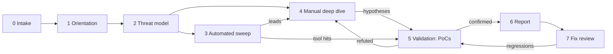

# The Audit Lifecycle with AI in the Loop

A smart contract audit is a time-boxed, adversarial review that ends in a report. AI changes how hours are spent within that box, not the shape of the box. This playbook assigns each phase to **agent work** (broad, cheap, fallible) or **human work** (judgement, accountability).

## Phases

| Phase | Human | Agent |
|---|---|---|
| 0. Intake | scope, commit hash, threat assumptions | repo stats, dependency list, nSLOC, inheritance graph |
| 1. Orientation | read docs, talk to devs | summaries per contract, value-flow diagram draft |
| 2. Threat modelling | pick attacker goals | enumerate entry points, roles, external calls |
| 3. Automated sweep | review output | Slither/Aderyn, invariant drafts, fuzz campaigns |
| 4. Manual deep dive | **most hours here** | answer questions, trace call paths, write PoCs on request |
| 5. Validation | decide valid/invalid, severity | build and run PoCs, check duplicates |
| 6. Reporting | final wording, severity, sign-off | draft descriptions, consistency checks |
| 7. Fix review | verify fixes | diff analysis, re-run PoCs and invariants |

## The 70/30 rule of thumb

Teams that report good results with AI tend to aim for **agents doing ~70% of the mechanical breadth** (inventories, first-pass checks, test scaffolding) so that humans spend **more**, not fewer, hours in Phase 4. The failure mode is the reverse: trusting agent output and shrinking the manual review.

## Deliverables per phase

Make each phase produce an artifact in the audit repo, so work is reviewable:

```
audit/
  00-intake.md           scope, commit, nSLOC, out-of-scope
  01-system-notes.md     per-contract summaries (agent draft, human edited)
  02-threat-model.md     actors, assets, trust boundaries
  03-automated/          tool outputs + triage notes
  test/invariants/       property suites
  04-hypotheses.md       open questions → confirmed/refuted
  05-findings/           one file per finding, PoC linked
  06-report.md
```

## How the phases connect



Two arrows matter most. Automated output flows *into* manual review as leads, not into the report directly. And every finding passes through validation, where a PoC test or a clear written argument decides whether it is real.

## Budgeting the box

A useful planning number is review throughput in nSLOC per reviewer-day. Firms quote very different figures depending on code complexity; a few hundred nSLOC per reviewer-day for dense DeFi code is a common planning range. AI tooling should not change the quote you give a client until you have measured, on your own engagements, that it changes outcomes. Record per engagement: hours per phase, findings by severity, and which findings came from which source (manual, static tool, fuzzer, agent hypothesis). After five or six engagements you have real data on where the agent helps.

## Worked example: an intake pack in fifteen minutes

Not executed in this book's CI; the commands, code and expected outputs below are illustrative. Verify locally before relying on them.

Intake is the most mechanical phase, so it is a good first place to automate. The goal is `audit/00-intake.md` with facts a human checks in five minutes.

**Step 1 – pin the commit.**

```bash
git clone <client-repo> target && cd target
git checkout <agreed-commit>
git rev-parse HEAD > ../audit/COMMIT
```

**Step 2 – size and inventory.** Count nSLOC with a tool rather than by hand. `cloc` gives a rough figure; Solidity-aware counters such as `solidity-code-metrics` or Aderyn's report give normalised counts.

```bash
cloc --include-lang=Solidity src/
aderyn . -o ../audit/03-automated/aderyn.md   # report includes nSLOC per file
```

**Step 3 – structure.** Use Slither printers for inheritance and per-contract summaries:

```bash
slither . --print inheritance-graph      # writes a .dot file
slither . --print contract-summary > ../audit/03-automated/summary.txt
```

**Step 4 – agent draft.** Give the agent the printer outputs and the docs and ask for `00-intake.md` with: scope table (file, nSLOC, in/out of scope), external dependencies and their versions, privileged roles, and open questions for the client. Instruct it to cite file paths for every row.

**Step 5 – human check.** Compare the scope table to the engagement letter. Confirm out-of-scope files are excluded and that dependency versions match `foundry.toml` or `package.json`. Send open questions to the client on day one.

Expected output: a one-page intake note with a scope table and five to fifteen questions. If the agent invented a role or a dependency, the citation check catches it.

## Common pitfalls

- **Auditing the wrong commit.** Clients push during the audit. Pin the hash and diff any later changes explicitly.
- **Letting agent summaries replace reading.** Summaries are an index into the code, not a substitute.
- **Shrinking manual hours because tools ran.** The automated sweep finds the easy bugs; the expensive ones still need deep review.
- **No source attribution for findings.** Without it you cannot tell whether the agent is paying for itself.
- **Leaving fix review to the agent.** A fix can be correct for the PoC and still wrong for a variant. A human signs off.

## Exercises

1. Time-log your next review by phase. Where would an agent save the most hours?
2. Create the folder layout above as a template repository.
3. Write a one-page rule for your team: what an agent may never decide alone.

## Further reading

- Trail of Bits, "Building Secure Contracts": <https://secure-contracts.com>
- OpenZeppelin, "What is a smart contract audit?" (blog)
- Cyfrin Updraft security course: <https://updraft.cyfrin.io>
- Consensys Diligence audit reports (examples of structure): <https://consensys.io/diligence/audits/>
