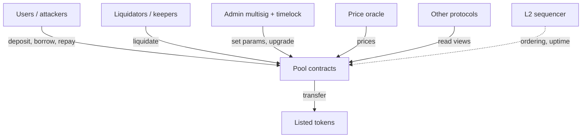

# Threat Modelling for Protocols

Generic STRIDE works poorly on DeFi. Protocol threat models should centre on **value**: where it sits, who can move it, and which external facts (prices, messages, time) the movement depends on.

## Four questions

1. **Assets:** what tokens, positions and privileges exist? Where are they held?
2. **Actors:** users, liquidators, keepers, admins, oracles, bridges, MEV searchers, and the other protocols that call ours.
3. **Trust assumptions:** what must be honest? (Admin multisig, oracle, sequencer, relayer set.)
4. **External facts:** prices, timestamps, block numbers, cross-chain messages, token behaviour.

## Agent-assisted inventory

A model with the repo can draft these tables quickly. Make it cite code:

```
| Function | Visibility | Modifiers | Moves value? | External calls | Reads oracle? |
|---|---|---|---|---|---|
| deposit  | external | nonReentrant | in  | asset.transferFrom | no  |
| liquidate| external | -            | out | oracle.latestRoundData, asset.transfer | yes |
```

Check the table mechanically (Slither's `function-summary` and `vars-and-auth` printers produce most of it), then let the human add the column that matters: **"What breaks if this is called at the worst possible moment?"**

## Attacker goals list

- Withdraw more than deposited.
- Borrow without enough collateral.
- Prevent liquidation of own position, or force liquidation of others.
- Lock others' funds (griefing, DoS).
- Take over a privileged role.
- Make the protocol accept a false external fact.

For each goal, write the **shortest plausible path** and assign it to a reviewer. This list becomes `04-hypotheses.md`.

## Composability threats

Ask explicitly: which other protocols read our state (read-only reentrancy exposure), and which tokens can be listed (fee-on-transfer, rebasing, 777 hooks, pausable, blocklists, non-standard return values)? Many incidents come from an *integration* assumption, not from the code under review.

## Trust boundaries in a typical lending market



Every arrow into the pool is a trust boundary. For each one, write what the pool assumes about the caller or data, and what happens if the assumption fails. For example, the oracle arrow assumes fresh, unmanipulated prices with known decimals; the "other protocols" arrow assumes they read consistent state, which read-only reentrancy breaks.

## Worked example: a threat model for a small vault

Not executed in this book's CI; the commands, code and expected outputs below are illustrative. Verify locally before relying on them.

Assume a single-asset ERC-4626 vault that deposits into an external lending market and has an admin who can change the strategy.

**Step 1 – generate the function table mechanically.**

```bash
slither . --print function-summary > fs.txt
slither . --print vars-and-auth > auth.txt
```

`function-summary` lists visibility, modifiers, state reads/writes and external calls per function; `vars-and-auth` lists state variables written and the `msg.sender` conditions guarding each function.

**Step 2 – agent draft.** Give the agent both outputs and the docs. Ask for the four-question tables (assets, actors, trust assumptions, external facts) with a code citation per row, and an attacker-goal table with "shortest plausible path".

**Step 3 – human pass.** Add the "worst moment" column. For the vault, the answers might look like this:

| Function | Worst moment | Hypothesis |
|---|---|---|
| `deposit` | first deposit into an empty vault | inflation via donation makes the next depositor's shares round to zero |
| `harvest` | right after a large deposit | yield attributed to the new depositor |
| `setStrategy` | while funds are in the old strategy | funds stranded or double-counted |
| `withdraw` | when the external market is paused | withdrawals revert, users trapped |

**Step 4 – assign.** Each row becomes an entry in `04-hypotheses.md` with an owner and a planned check (test, invariant, or manual trace).

**Step 5 – revisit.** At the midpoint of the audit, update the model with anything learned. Threat models that are written once on day one and never touched miss what reviewers discover.

## Token behaviour checklist

Before the deep dive, decide which token behaviours are in scope and record the decision:

| Behaviour | Example risk | Decision to record |
|---|---|---|
| Fee on transfer | received amount less than parameter | supported / rejected / documented |
| Rebasing | stored balances drift from real ones | |
| Hooks (ERC-777, ERC-1155) | reentrancy during transfer | |
| Blocklists / pausable | stuck funds, failed liquidations | |
| Non-standard return values | silent transfer failure | use SafeERC20 |
| Unusual decimals | price and share maths off by powers of ten | |

## Common pitfalls

- **Threat modelling the code instead of the system.** Keepers, oracles and the admin process are part of the attack surface.
- **"Admin is trusted" without bounds.** Record exactly which admin actions are trusted and whether a timelock applies; contests and clients disagree on this often.
- **Ignoring MEV.** Any function whose outcome depends on ordering (liquidations, swaps, oracle updates) needs an ordering threat.
- **Agent tables without citations.** An uncited row is a guess. Reject it.
- **Never updating the model.** Hypotheses from the deep dive should flow back into the threat model.

## Exercises

1. Write a threat model for a lending market in under one page using the four questions.
2. Use Slither printers to generate the function table automatically, and compare it with a model-generated version.
3. List five token behaviours that broke protocols in real incidents.

## Further reading

- Slither printers: <https://github.com/crytic/slither/wiki/Printer-documentation>
- Weird ERC20 tokens: <https://github.com/d-xo/weird-erc20>
- Shostack, *Threat Modeling: Designing for Security*
- See the `threat-modeling` approach in general appsec, adapted here to value flows.
